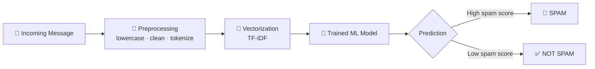

<svg xmlns="http://www.w3.org/2000/svg" viewBox="0 0 900 300" width="900" height="300" font-family="Segoe UI,Helvetica,Arial,sans-serif" xmlns:c2pa="http://c2pa.org/manifest"><metadata><c2pa:manifest>AAAWgmp1bWIAAAAeanVtZGMycGEAEQAQgAAAqgA4m3EDYzJwYQAAABZcanVtYgAAAEdqdW1kYzJtYQARABCAAACqADibcQN1cm46YzJwYTo3Mzg5MmM0Yi1mNDI2LTQ4N2ItOTJhNC0xYjZlOTYwNWFjY2QAAAADl2p1bWIAAAApanVtZGMyYXMAEQAQgAAAqgA4m3EDYzJwYS5hc3NlcnRpb25zAAAAALxqdW1iAAAARGp1bWRjYm9yABEAEIAAAKoAOJtxE2MycGEuaW5ncmVkaWVudC52MwAAAAAYYzJzaDbnjoK204ZgcK90A3sxrggAAABwY2JvcqNpZGM6Zm9ybWF0bWltYWdlL3N2Zyt4bWxqaW5zdGFuY2VJRHgseG1wOmlpZDozMTlhMDk3Ni0zYzFjLTQ3Y2ItODg4MC1mMzU3NTM4MmI5OTdscmVsYXRpb25zaGlwaHBhcmVudE9mAAAB4mp1bWIAAABBanVtZGNib3IAEQAQgAAAqgA4m3ETYzJwYS5hY3Rpb25zLnYyAAAAABhjMnNodtX73KFGlNDwPzXQKyZkMQAAAZljYm9yomdhY3Rpb25zgqJmYWN0aW9ua2MycGEub3BlbmVkanBhcmFtZXRlcnOha2luZ3JlZGllbnRzgaJjdXJseC1zZWxmI2p1bWJmPWMycGEuYXNzZXJ0aW9ucy9jMnBhLmluZ3JlZGllbnQudjNkaGFzaFggKEi5tsoQqdE5WDXGhzL0QyOYhA87kJPszwkZzh2kzuukZmFjdGlvbngdY29tLmFudGhyb3BpYy5jbGF1ZGUucHJvdmlkZWRqcGFyYW1ldGVyc6F4H2NvbS5hbnRocm9waWMub3JpZ2luLWNvbmZpZGVuY2VndW5rbm93bmtkZXNjcmlwdGlvbnhmQ2xhdWRlIHByb3ZpZGVkIHRoaXMgZmlsZSBhdCB0aGUgcmVxdWVzdCBvZiBhIHVzZXIgYW5kIG1heSBoYXZlIGNyZWF0ZWQgb3IgbW9kaWZpZWQgdGhlIGZpbGUgY29udGVudHMubXNvZnR3YXJlQWdlbnShZG5hbWVmQ2xhdWRlcmFsbEFjdGlvbnNJbmNsdWRlZPUAAADIanVtYgAAAEBqdW1kY2JvcgARABCAAACqADibcRNjMnBhLmhhc2guZGF0YQAAAAAYYzJzaNJeySqi6NTEs+9Kw0LK5aQAAACAY2JvcqVjYWxnZnNoYTI1NmNwYWRNAAAAAAAAAAAAAAAAAGRoYXNoWCDAfKgU3F+JgudH10OnIjPrgPa9SuapFivsZ/FEthrLWWRuYW1lbmp1bWJmIG1hbmlmZXN0amV4Y2x1c2lvbnOBomVzdGFydBjIZmxlbmd0aBkeBAAAAj5qdW1iAAAAJ2p1bWRjMmNsABEAEIAAAKoAOJtxA2MycGEuY2xhaW0udjIAAAACD2Nib3KlY2FsZ2ZzaGEyNTZpc2lnbmF0dXJleE1zZWxmI2p1bWJmPS9jMnBhL3VybjpjMnBhOjczODkyYzRiLWY0MjYtNDg3Yi05MmE0LTFiNmU5NjA1YWNjZC9jMnBhLnNpZ25hdHVyZWppbnN0YW5jZUlEeCx4bXA6aWlkOjE1OGEzZGMxLWMxNTUtNDI1NS04NTAxLWMxZDNmZmNmMGEwZnJjcmVhdGVkX2Fzc2VydGlvbnODomN1cmx4LXNlbGYjanVtYmY9YzJwYS5hc3NlcnRpb25zL2MycGEuaW5ncmVkaWVudC52M2RoYXNoWCAoSLm2yhCp0TlYNcaHMvRDI5iEDzuQk+zPCRnOHaTO66JjdXJseCpzZWxmI2p1bWJmPWMycGEuYXNzZXJ0aW9ucy9jMnBhLmFjdGlvbnMudjJkaGFzaFgg7oaJ+cKygb0DYpTY40URbqbcBp1dC7DgM/zs3o2WgkOiY3VybHgpc2VsZiNqdW1iZj1jMnBhLmFzc2VydGlvbnMvYzJwYS5oYXNoLmRhdGFkaGFzaFggpWvD0nWT8CUffJH13tgMMEtINqZBFILKCsuNB0gmXsN0Y2xhaW1fZ2VuZXJhdG9yX2luZm+jZG5hbWVvQW50aHJvcGljIEZpbGVzZ3ZlcnNpb25lMS4wLjBrc3BlY1ZlcnNpb25lMi40LjAAABA4anVtYgAAAChqdW1kYzJjcwARABCAAACqADibcQNjMnBhLnNpZ25hdHVyZQAAABAIY2JvctKEWQISogEmGCFZAgowggIGMIIBjaADAgECAhRA5aAK7sI50L64g/oGQgU9Z1UTADAKBggqhkjOPQQDAzBJMRcwFQYDVQQKEw5BbnRocm9waWMsIFBCQzEuMCwGA1UEAxMlQW50aHJvcGljIENvbnRlbnQgQ3JlZGVudGlhbHMgUm9vdCBDQTAeFw0yNjA4MDcxODQzNTZaFw0yODA4MDYxOTQzNTZaMEQxFzAVBgNVBAoTDkFudGhyb3BpYywgUEJDMSkwJwYDVQQDEyBBbnRocm9waWMgQ2xhdWRlIENvbnRlbnQgU2lnbmluZzBZMBMGByqGSM49AgEGCCqGSM49AwEHA0IABJh6CmvLUBgFFNU0vUKlOVtE6djd17L5SuwX0LemFisBM3dkd/3cyjxFA3Qo5S46fX0/ihY0VZ7mfb9KF703t5OjWDBWMA4GA1UdDwEB/wQEAwIHgDAVBgNVHSUEDjAMBgorBgEEAYPoXgIBMAwGA1UdEwEB/wQCMAAwHwYDVR0jBBgwFoAUzlHiBIFOZFsj+OPEz5o+nMHXXMIwCgYIKoZIzj0EAwMDZwAwZAIwMXMdFJ4BetLLVY7ORuE9noqbbAZOZn/aArXyTwFAZfKrPzxF2vPoJNf1+UCdg1XGAjBwX1zd9WGqYkqmL5SFqw1QySjr1zJfpJM9+1rdDwSPLMOPOjKuiXjoU/pUUeG9RwmhY3BhZFkNngAAAAAAAAAAAAAAAAAAAAAAAAAAAAAAAAAAAAAAAAAAAAAAAAAAAAAAAAAAAAAAAAAAAAAAAAAAAAAAAAAAAAAAAAAAAAAAAAAAAAAAAAAAAAAAAAAAAAAAAAAAAAAAAAAAAAAAAAAAAAAAAAAAAAAAAAAAAAAAAAAAAAAAAAAAAAAAAAAAAAAAAAAAAAAAAAAAAAAAAAAAAAAAAAAAAAAAAAAAAAAAAAAAAAAAAAAAAAAAAAAAAAAAAAAAAAAAAAAAAAAAAAAAAAAAAAAAAAAAAAAAAAAAAAAAAAAAAAAAAAAAAAAAAAAAAAAAAAAAAAAAAAAAAAAAAAAAAAAAAAAAAAAAAAAAAAAAAAAAAAAAAAAAAAAAAAAAAAAAAAAAAAAAAAAAAAAAAAAAAAAAAAAAAAAAAAAAAAAAAAAAAAAAAAAAAAAAAAAAAAAAAAAAAAAAAAAAAAAAAAAAAAAAAAAAAAAAAAAAAAAAAAAAAAAAAAAAAAAAAAAAAAAAAAAAAAAAAAAAAAAAAAAAAAAAAAAAAAAAAAAAAAAAAAAAAAAAAAAAAAAAAAAAAAAAAAAAAAAAAAAAAAAAAAAAAAAAAAAAAAAAAAAAAAAAAAAAAAAAAAAAAAAAAAAAAAAAAAAAAAAAAAAAAAAAAAAAAAAAAAAAAAAAAAAAAAAAAAAAAAAAAAAAAAAAAAAAAAAAAAAAAAAAAAAAAAAAAAAAAAAAAAAAAAAAAAAAAAAAAAAAAAAAAAAAAAAAAAAAAAAAAAAAAAAAAAAAAAAAAAAAAAAAAAAAAAAAAAAAAAAAAAAAAAAAAAAAAAAAAAAAAAAAAAAAAAAAAAAAAAAAAAAAAAAAAAAAAAAAAAAAAAAAAAAAAAAAAAAAAAAAAAAAAAAAAAAAAAAAAAAAAAAAAAAAAAAAAAAAAAAAAAAAAAAAAAAAAAAAAAAAAAAAAAAAAAAAAAAAAAAAAAAAAAAAAAAAAAAAAAAAAAAAAAAAAAAAAAAAAAAAAAAAAAAAAAAAAAAAAAAAAAAAAAAAAAAAAAAAAAAAAAAAAAAAAAAAAAAAAAAAAAAAAAAAAAAAAAAAAAAAAAAAAAAAAAAAAAAAAAAAAAAAAAAAAAAAAAAAAAAAAAAAAAAAAAAAAAAAAAAAAAAAAAAAAAAAAAAAAAAAAAAAAAAAAAAAAAAAAAAAAAAAAAAAAAAAAAAAAAAAAAAAAAAAAAAAAAAAAAAAAAAAAAAAAAAAAAAAAAAAAAAAAAAAAAAAAAAAAAAAAAAAAAAAAAAAAAAAAAAAAAAAAAAAAAAAAAAAAAAAAAAAAAAAAAAAAAAAAAAAAAAAAAAAAAAAAAAAAAAAAAAAAAAAAAAAAAAAAAAAAAAAAAAAAAAAAAAAAAAAAAAAAAAAAAAAAAAAAAAAAAAAAAAAAAAAAAAAAAAAAAAAAAAAAAAAAAAAAAAAAAAAAAAAAAAAAAAAAAAAAAAAAAAAAAAAAAAAAAAAAAAAAAAAAAAAAAAAAAAAAAAAAAAAAAAAAAAAAAAAAAAAAAAAAAAAAAAAAAAAAAAAAAAAAAAAAAAAAAAAAAAAAAAAAAAAAAAAAAAAAAAAAAAAAAAAAAAAAAAAAAAAAAAAAAAAAAAAAAAAAAAAAAAAAAAAAAAAAAAAAAAAAAAAAAAAAAAAAAAAAAAAAAAAAAAAAAAAAAAAAAAAAAAAAAAAAAAAAAAAAAAAAAAAAAAAAAAAAAAAAAAAAAAAAAAAAAAAAAAAAAAAAAAAAAAAAAAAAAAAAAAAAAAAAAAAAAAAAAAAAAAAAAAAAAAAAAAAAAAAAAAAAAAAAAAAAAAAAAAAAAAAAAAAAAAAAAAAAAAAAAAAAAAAAAAAAAAAAAAAAAAAAAAAAAAAAAAAAAAAAAAAAAAAAAAAAAAAAAAAAAAAAAAAAAAAAAAAAAAAAAAAAAAAAAAAAAAAAAAAAAAAAAAAAAAAAAAAAAAAAAAAAAAAAAAAAAAAAAAAAAAAAAAAAAAAAAAAAAAAAAAAAAAAAAAAAAAAAAAAAAAAAAAAAAAAAAAAAAAAAAAAAAAAAAAAAAAAAAAAAAAAAAAAAAAAAAAAAAAAAAAAAAAAAAAAAAAAAAAAAAAAAAAAAAAAAAAAAAAAAAAAAAAAAAAAAAAAAAAAAAAAAAAAAAAAAAAAAAAAAAAAAAAAAAAAAAAAAAAAAAAAAAAAAAAAAAAAAAAAAAAAAAAAAAAAAAAAAAAAAAAAAAAAAAAAAAAAAAAAAAAAAAAAAAAAAAAAAAAAAAAAAAAAAAAAAAAAAAAAAAAAAAAAAAAAAAAAAAAAAAAAAAAAAAAAAAAAAAAAAAAAAAAAAAAAAAAAAAAAAAAAAAAAAAAAAAAAAAAAAAAAAAAAAAAAAAAAAAAAAAAAAAAAAAAAAAAAAAAAAAAAAAAAAAAAAAAAAAAAAAAAAAAAAAAAAAAAAAAAAAAAAAAAAAAAAAAAAAAAAAAAAAAAAAAAAAAAAAAAAAAAAAAAAAAAAAAAAAAAAAAAAAAAAAAAAAAAAAAAAAAAAAAAAAAAAAAAAAAAAAAAAAAAAAAAAAAAAAAAAAAAAAAAAAAAAAAAAAAAAAAAAAAAAAAAAAAAAAAAAAAAAAAAAAAAAAAAAAAAAAAAAAAAAAAAAAAAAAAAAAAAAAAAAAAAAAAAAAAAAAAAAAAAAAAAAAAAAAAAAAAAAAAAAAAAAAAAAAAAAAAAAAAAAAAAAAAAAAAAAAAAAAAAAAAAAAAAAAAAAAAAAAAAAAAAAAAAAAAAAAAAAAAAAAAAAAAAAAAAAAAAAAAAAAAAAAAAAAAAAAAAAAAAAAAAAAAAAAAAAAAAAAAAAAAAAAAAAAAAAAAAAAAAAAAAAAAAAAAAAAAAAAAAAAAAAAAAAAAAAAAAAAAAAAAAAAAAAAAAAAAAAAAAAAAAAAAAAAAAAAAAAAAAAAAAAAAAAAAAAAAAAAAAAAAAAAAAAAAAAAAAAAAAAAAAAAAAAAAAAAAAAAAAAAAAAAAAAAAAAAAAAAAAAAAAAAAAAAAAAAAAAAAAAAAAAAAAAAAAAAAAAAAAAAAAAAAAAAAAAAAAAAAAAAAAAAAAAAAAAAAAAAAAAAAAAAAAAAAAAAAAAAAAAAAAAAAAAAAAAAAAAAAAAAAAAAAAAAAAAAAAAAAAAAAAAAAAAAAAAAAAAAAAAAAAAAAAAAAAAAAAAAAAAAAAAAAAAAAAAAAAAAAAAAAAAAAAAAAAAAAAAAAAAAAAAAAAAAAAAAAAAAAAAAAAAAAAAAAAAAAAAAAAAAAAAAAAAAAAAAAAAAAAAAAAAAAAAAAAAAAAAAAAAAAAAAAAAAAAAAAAAAAAAAAAAAAAAAAAAAAAAAAAAAAAAAAAAAAAAAAAAAAAAAAAAAAAAAAAAAAAAAAAAAAAAAAAAAAAAAAAAAAAAAAAAAAAAAAAAAAAAAAAAAAAAAAAAAAAAAAAAAAAAAAAAAAAAAAAAAAAAAAAAAAAAAAAAAAAAAAAAAAAAAAAAAAAAAAAAAAAAAAAAAAAAAAAAAAAAAAAAAAAAAAAAAAAAAAAAAAAAAAAAAAAAAAAAAAAAAAAAAAAAAAAAAAAAAAAAAAAAAAAAAAAAAAAAAAAAAAAAAAAAAAAAAAAAAAAAAAAAAAAAAAAAAAAAAAAAAAAAAAAAAAAAAAAAAAAAAAAAAAAAAAAAAAAAAAAAAAAAAAAAAAAAAAAAAAAAAAAAAAAAAAAAAAAAAAAAAAAAAAAAAAAAAAAAAAAAAAAAAAAAAAAAAAAAAAAAAAAAAAAAAAAAAAAAAAAAAAAAAAAAAAAAAAAAAAAAAAAAAAAAAAAAAAAAAAAAAAAAAAAAAAAAAAAAAAAAAAAAAAAAAAAAAAAAAAAAAAAAAAAAAAAAAAAAAAAAAAAAAAAAAAAAAAAAAAAAAAAAAAAAAAAAAAAAAAAAAAAAAAAAAAAAAAAAAAAAAAAAAAAAAAAAAAAAAAAAAAAAAAAAAAAAAAAAAAAAAAAAAAAAAAAAAAAAAAAAAAAAAAAAAAAAAAAAAAAAAAAAAAAAAAAAAAAAAAAAAAAAAAAAAAAAAAAAAAAAAAAAAAAAAAAAAAAAAAAAAAAAAAAAAAAAAAAAAAAAAAAAAAAAAAAAAAAAAAAAAAAAAAAAAAAAAAAAAAAAAAAAAAAAAAAAAAAAAAAAAAAAAAAAAAAAAAAAAAAAAAAAAAAAAAAAAAAAAAAAAAAAAAAAAAAAAAAAAAAAAAAAAAAAAAAAAAAAAAAAAAAAAAAAAAAAAAAAAAAAAAAAAAAAAAAAAAAAAAAAAAAAAAAAAAAAAAAAAAAAAAAAAAAAAAAAAAAAAAAAAAAAAAAAAAAAAAAAAAAAAAAAAAAAAAAAAAAAAAAAAAAAAAAAAAAAAAAAAAAAAAAAAAAAAAAAAAAAAAAAAAAAAAAAAAAAAAAAAAAAAAAAAAAAAAAAAAAAAAAAAAAAAAAAAAAAAAAAAAAAAAAAAAAAAAAAAAAAAAAAAAAAAAAAAAAAAAAAAAAAAAAAAAAAAAAAAAAAAAAAAAAAAAAAAAAAAAAAAAAAAAAAAAAAAAAAAAAAAAAAAAAAAAAAAAAAAAAAAAAAAAAAAAAAAAAAAAAAAAAAAAAAAAAAAAAAAAAAAAAAAAAAAAAAAAAAAAAAAAAAAAAAPZYQPSbiU9x821F1lPGWXWhLp/hGEOQZ7mItMtBvOjzlX+flLgSvDQBSvADWAcJZrL1ZPVAvjEJPawoAWt2ktEfUtY=</c2pa:manifest></metadata>
<defs><marker id="ar" markerWidth="8" markerHeight="8" refX="6" refY="4" orient="auto"><path d="M0 0 L8 4 L0 8 z" fill="#475569"/></marker>
<linearGradient id="bg" x1="0" y1="0" x2="1" y2="1"><stop offset="0" stop-color="#020617"/><stop offset="1" stop-color="#1e1b4b"/></linearGradient></defs>
<rect width="900" height="300" rx="20" fill="url(#bg)"/>
<text x="450" y="40" text-anchor="middle" fill="#f8fafc" font-size="22" font-weight="700">Message Intelligence System</text>
<text x="450" y="62" text-anchor="middle" fill="#94a3b8" font-size="13">Is this email SPAM or HAM? Watch it flow through the pipeline</text>
<path d="M172 130 L208 130" stroke="#475569" stroke-width="2" marker-end="url(#ar)"/><path d="M342 130 L378 130" stroke="#475569" stroke-width="2" marker-end="url(#ar)"/><path d="M512 130 L548 130" stroke="#475569" stroke-width="2" marker-end="url(#ar)"/><path d="M682 130 L718 130" stroke="#475569" stroke-width="2" marker-end="url(#ar)"/>
<rect x="40" y="90" width="130" height="80" rx="12" fill="#0f172a" stroke="#334155" stroke-width="2"/>
<text x="105" y="122" text-anchor="middle" fill="#f1f5f9" font-size="16" font-weight="700">1. Raw Email</text>
<text x="105" y="148" text-anchor="middle" fill="#94a3b8" font-size="12">subject + body</text>
<rect x="210" y="90" width="130" height="80" rx="12" fill="#0f172a" stroke="#334155" stroke-width="2"/>
<text x="275" y="122" text-anchor="middle" fill="#f1f5f9" font-size="16" font-weight="700">2. Preprocess</text>
<text x="275" y="148" text-anchor="middle" fill="#94a3b8" font-size="12">clean · tokenize</text>
<rect x="380" y="90" width="130" height="80" rx="12" fill="#0f172a" stroke="#334155" stroke-width="2"/>
<text x="445" y="122" text-anchor="middle" fill="#f1f5f9" font-size="16" font-weight="700">3. Vectorize</text>
<text x="445" y="148" text-anchor="middle" fill="#94a3b8" font-size="12">TF-IDF features</text>
<rect x="550" y="90" width="130" height="80" rx="12" fill="#0f172a" stroke="#334155" stroke-width="2"/>
<text x="615" y="122" text-anchor="middle" fill="#f1f5f9" font-size="16" font-weight="700">4. ML Model</text>
<text x="615" y="148" text-anchor="middle" fill="#94a3b8" font-size="12">classify</text>

<rect x="730" y="90" width="130" height="80" rx="12" fill="#0f172a" stroke="#334155" stroke-width="2"/>
<text x="795" y="112" text-anchor="middle" fill="#94a3b8" font-size="12">5. Verdict</text>
<g><text x="795" y="150" text-anchor="middle" fill="#ef4444" font-size="26" font-weight="800" opacity="0">SPAM
<animate attributeName="opacity" values="0;0;1;1;0;0" keyTimes="0;0.44;0.46;0.6;0.62;1" dur="16s" repeatCount="indefinite"/></text>
<text x="795" y="150" text-anchor="middle" fill="#22c55e" font-size="26" font-weight="800" opacity="1">HAM
<animate attributeName="opacity" values="1;1;0;0;1;1" keyTimes="0;0.1;0.12;0.94;0.96;1" dur="16s" repeatCount="indefinite"/></text></g>
<rect x="37" y="87" width="136" height="86" rx="14" fill="none" stroke="#38bdf8" stroke-width="3" opacity="0"><animate attributeName="opacity" values="0;0;1;0;0;1;0;0" keyTimes="0.0000;0.0220;0.0520;0.0820;0.5220;0.5520;0.5820;1.0000" dur="16s" repeatCount="indefinite"/></rect>
<rect x="207" y="87" width="136" height="86" rx="14" fill="none" stroke="#38bdf8" stroke-width="3" opacity="0"><animate attributeName="opacity" values="0;0;1;0;0;1;0;0" keyTimes="0.0000;0.1151;0.1451;0.1751;0.6151;0.6451;0.6751;1.0000" dur="16s" repeatCount="indefinite"/></rect>
<rect x="377" y="87" width="136" height="86" rx="14" fill="none" stroke="#38bdf8" stroke-width="3" opacity="0"><animate attributeName="opacity" values="0;0;1;0;0;1;0;0" keyTimes="0.0000;0.2082;0.2382;0.2682;0.7082;0.7382;0.7682;1.0000" dur="16s" repeatCount="indefinite"/></rect>
<rect x="547" y="87" width="136" height="86" rx="14" fill="none" stroke="#38bdf8" stroke-width="3" opacity="0"><animate attributeName="opacity" values="0;0;1;0;0;1;0;0" keyTimes="0.0000;0.3013;0.3313;0.3613;0.8013;0.8313;0.8613;1.0000" dur="16s" repeatCount="indefinite"/></rect>
<rect x="727" y="87" width="136" height="86" rx="14" fill="none" stroke="#38bdf8" stroke-width="3" opacity="0"><animate attributeName="opacity" values="0;0;1;0;0;1;0;0" keyTimes="0.0000;0.3999;0.4299;0.4599;0.8999;0.9299;0.9599;1.0000" dur="16s" repeatCount="indefinite"/></rect>

<g transform="translate(10,130)" opacity="1"><rect x="-16" y="-11" width="32" height="22" rx="3" fill="#ef4444"/><path d="M-16 -11 L0 3 L16 -11" fill="none" stroke="#fff" stroke-width="1.5"/>
<animateMotion dur="16s" repeatCount="indefinite" calcMode="linear" keyPoints="0;1;1" keyTimes="0;0.46;1" path="M0,0 L840,0"/>
<animate attributeName="opacity" values="1;1;0;0" keyTimes="0;0.46;0.47;1" dur="16s" repeatCount="indefinite"/></g>
<g transform="translate(10,130)" opacity="0"><rect x="-16" y="-11" width="32" height="22" rx="3" fill="#3b82f6"/><path d="M-16 -11 L0 3 L16 -11" fill="none" stroke="#fff" stroke-width="1.5"/>
<animateMotion dur="16s" repeatCount="indefinite" calcMode="linear" keyPoints="0;0;1;1" keyTimes="0;0.5;0.96;1" path="M0,0 L840,0"/>
<animate attributeName="opacity" values="0;0;1;1;0;0" keyTimes="0;0.5;0.501;0.96;0.97;1" dur="16s" repeatCount="indefinite"/></g>


<div align="center">

# 📧 Message Intelligence System

**An end-to-end machine learning system that decides: is this email / message _SPAM_ or _NOT SPAM (HAM)_?**


</div>

---

## ✨ Overview

Message Intelligence System reads a raw email or text message, cleans it, converts it into numerical features, and passes it to a trained classifier that returns a clear verdict: **SPAM** 🚫 or **HAM** ✅ (legitimate).

## 🔄 High-Level Flow



| Step | What happens |
|------|--------------|
| **1. Input** | User pastes an email or message into the app |
| **2. Preprocess** | Lowercasing, removing punctuation/stop-words, tokenizing/stemming |
| **3. Vectorize** | Text is converted into numeric features (TF-IDF) |
| **4. Predict** | The saved model in `Model/` scores the message |
| **5. Verdict** | The app displays **SPAM** or **NOT SPAM** |

## 📁 Project Structure

```
Message-Intelligence-System-/
├── Data/            # Dataset used for training & testing
├── Model/           # Saved/trained model (and vectorizer)
├── Notebook/        # Exploration, training & evaluation notebooks
├── app.py           # Application entry point (prediction UI)
├── requirements.txt # Python dependencies
└── README.md
```

## 🚀 Getting Started

```bash
# 1. Clone the repository
git clone https://github.com/TrivediMan/Message-Intelligence-System-.git
cd Message-Intelligence-System-

# 2. (Optional) create a virtual environment
python -m venv venv
source venv/bin/activate        # Windows: venv\Scripts\activate

# 3. Install dependencies
pip install -r requirements.txt

# 4. Run the app
python app.py
# If app.py uses Streamlit:  streamlit run app.py
```

## 🧪 Example

| Message | Prediction |
|---------|------------|
| "Congratulations! You WON a free prize, click now!!!" | 🚫 **SPAM** |
| "Hi team, the meeting is moved to 3 PM tomorrow." | ✅ **NOT SPAM** |

## 🧠 How the Model Works

1. **Training** (see `Notebook/`): the labelled dataset in `Data/` is cleaned, vectorized and used to train a classifier.
2. **Evaluation**: accuracy, precision, recall and F1-score are checked — precision matters most so real emails are not wrongly flagged.
3. **Deployment**: the trained model is saved to `Model/` and loaded by `app.py` for instant predictions.

## 🛠️ Tech Stack

- **Language:** Python
- **NLP / ML:** scikit-learn, NLTK / pandas / NumPy
- **Interface:** `app.py`

## 🔮 Future Improvements

- [ ] Deep-learning models (LSTM / BERT)
- [ ] Multi-language support
- [ ] Gmail / Outlook inbox integration
- [ ] Explainable predictions (highlight spam-trigger words)
- [ ] REST API + Docker deployment

## 🤝 Contributing

Pull requests are welcome. For major changes, please open an issue first.

## 👤 Author

**TrivediMan** — [GitHub](https://github.com/TrivediMan)

---

<div align="center">⭐ If you find this useful, give the repo a star!</div>
<text x="450" y="225" text-anchor="middle" fill="#fca5a5" font-size="13">Pass 1: "WIN a FREE prize, click now!!!"  →  SPAM</text>
<text x="450" y="250" text-anchor="middle" fill="#93c5fd" font-size="13">Pass 2: "Meeting moved to 3 PM tomorrow"  →  HAM</text>
</svg>
